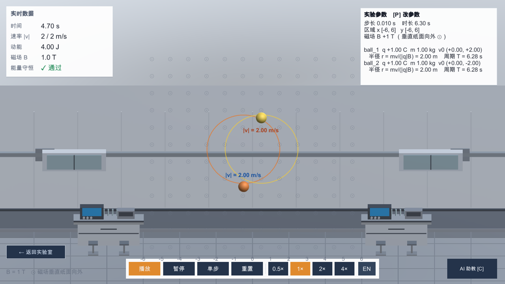
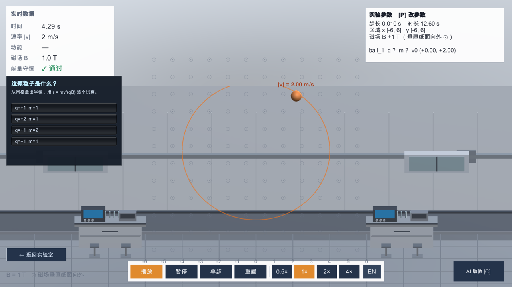
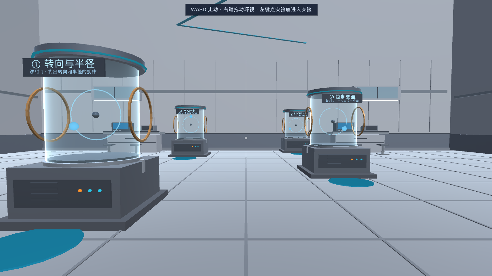
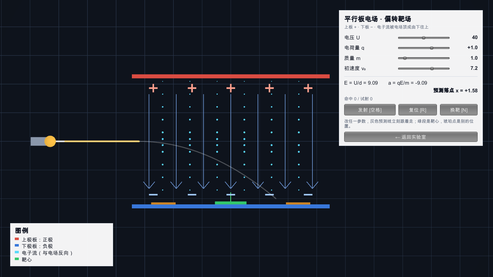
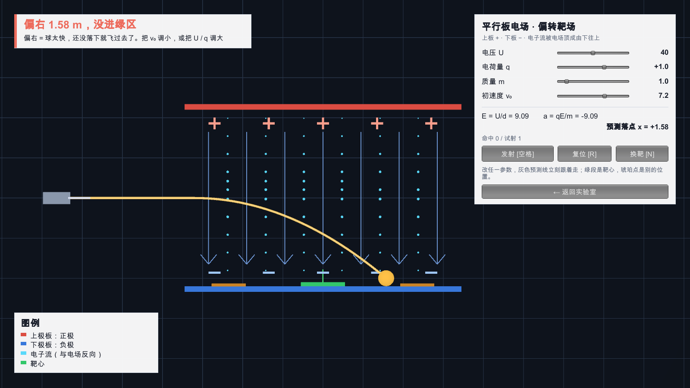
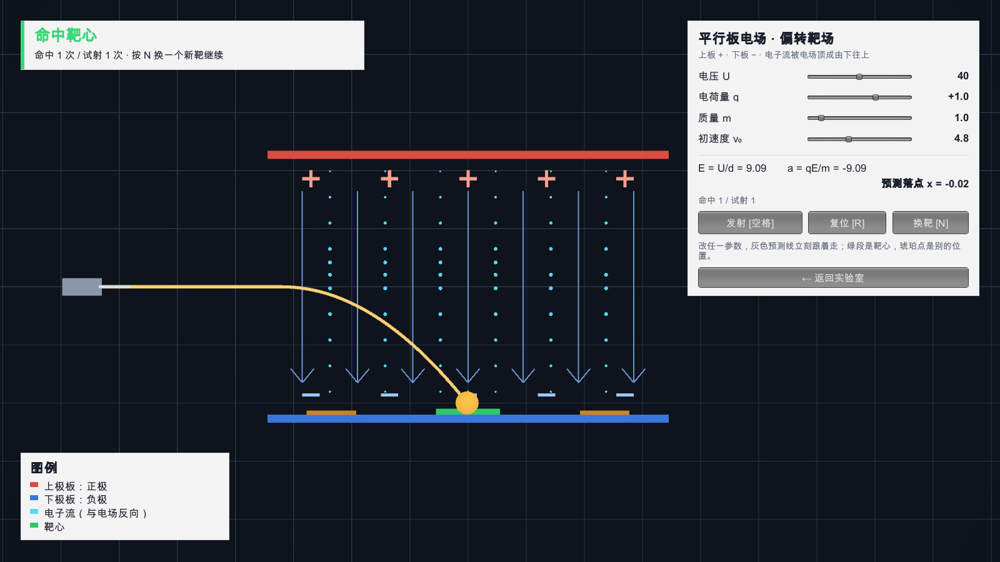

# ChargeMotionLab · 电荷在磁场中的运动

> 三台磁场实验舱、九个案例、一个“这颗粒子到底是什么”的挑战，外加一间平行板偏转靶场 —— 学生自己从轨迹里把荷质比量出来，再用同样的电场公式把小球打进靶心。

香港教育大学（EdUHK）MSc AI & Educational Technology · **INT6064** Coding and Computational Thinking（编码与计算思维）课程项目
作者：**黄炯桦（HUANG Jionghua）** · GitHub [@BBBrandon1221](https://github.com/BBBrandon1221)


---

## 这个项目在做什么

“电荷垂直射入匀强磁场做圆周运动、半径 r = mv/(qB)” 这条公式，讲一遍学生就忘。这里把它拆成三个课时，外加一间把同一套受力分析搬到匀强电场里的靶场。学生走进一间实验舱大厅，点开对应的舱，自己改参数、看轨迹、下结论：

| 课时 | 主题 | 案例 | 认知层次 |
|---|---|---|---|
| **① 转向与半径** | 找出转向和半径的规律 | 同种电荷 / 异种电荷 / 电荷量不同 | 找规律（pattern recognition） |
| **② 控制变量** | 一次只改一个量 | 速度不同 / 弱场 / 强场 / 质量不同 / 无磁场 | 算法与抽象（只改一个变量，看结果怎么变） |
| **③ 未知粒子** | 测出它的荷质比 | mystery：q、m、r、T 全部遮住 | 评估（从网格量半径，用 r = mv/(qB) 反算并验证） |
| **④ 粒子导航员** | 用磁场把粒子送进接收器 | 三关递进 + 预测弧线 + 前后轨迹对比 | 建模与设计（选方向 → 调半径 → 路径规划） |
| （可选）平行板偏转靶场 | 用电场公式把小球打进靶心 | 一块绿靶 + 四个可调参数 | 建模与试误（加 `-plate` 启动进入） |

> 第四站默认为**粒子导航员**（纯磁场，沿用现有 Boris 求解器）。小组原有的**平行板电场偏转靶场**完整保留：启动加 `-plate` 即回到旧入口；导航员的分镜剧本、成功/失败参数和自检见 [`docs/particle-navigator-guide.md`](docs/particle-navigator-guide.md)，平行板见 [`docs/plate-field-guide.md`](docs/plate-field-guide.md)。




课时三是一道真正的挑战题：粒子参数被遮成 `?`，动能显示 `—`（因为动能 = ½mv²，给了 v 就能反算 m，会把答案漏出去），学生只能从网格量半径、拿 r = mv/(qB) 逐个试算，最后在四选一答题卡上作答，答对后补一句“轨迹只能定出 q/m 的比值，定不出各自的值”。

## 第四课时：平行板偏转靶场



大厅里第四台舱是一块水平放置的平行板偏转靶场：上下两块极板（上正下负），板间有自上而下流动的电子流（粒子效果），左端固定一枚小球，右下方放一块绿色靶板。点进去以后拖四个滑块（电压 `U`、电荷量 `q`、质量 `m`、出射速度 `v₀`），按空格发射，看小球是打在绿靶上还是偏出去。



**默认开局是故意打不中的**：`v₀ = 7.2` 时落点偏右 1.58 m，第一次发射会拿到一个红色“偏了 1.58 m”的结算弹窗，红色投影线（灰色虚线是预测落点）一眼能看出落点在绿靶右侧。



把 `v₀` 拖到 4.8 左右，灰色预测线会实时收进绿靶（**抛物线随滑块实时重画**，不用发射就能预判），再次发射就是绿色“命中”弹窗。想让学生看反方向的失败，把 `v₀` 继续拖到 3.0，落点会跑到绿靶左侧 1.21 m —— 左右两种失败的建议是相反的（往右偏要调小、往左偏要调大），所以弹窗文案分开写了。



物理量之间的关系就是课本上那条。小球从中心线水平射入极板区（入口 x = −3.2、y = 0），板间场强 `E = U/d`，加速度 `a = qU/(md)`，落到下极板内表面需要走完 Δy = 2.0 m：

```
t = √(2Δy / a)                  ← 只跟 a 有关，与 v₀ 无关
x_落点 = −3.2 + v₀ · t
```

四个参数的方向感因此很直观：`v₀` 变大 → 落点右移；`U` 变大、`q` 变大、`m` 变小 → `a` 变大 → `t` 变短 → 落点左移。改任意一个滑块，灰色预测线立刻重画到新落点，不用发射就能预判 —— **抛物线是真的跟着滑块实时变的**。`G` 键开关预测线（课上可以先关掉让学生猜）。

详细的分镜剧本、参数参考表和判定阈值见 [`docs/plate-field-guide.md`](docs/plate-field-guide.md)。


## 功能

**实验舱大厅（2.5D 第一人称）**：四台玻璃舱 = 三个磁场课时 + 一间偏转靶场。WASD 走动、右键环视、点舱体或按 `1/2/3/4` 进入，`Esc` 退回大厅并站在刚才那台舱前。

**物理回放**：帧序列 JSON 驱动，播放 / 暂停 / 单步 / 重置 / 0.5×–4× 倍速；坐标网格与刻度、磁场符号（⊙ 出纸面 / ⊗ 入纸面）、轨迹线与理论圆参考、每颗粒子的速度标签、实时数据卡（速率、动能、磁感应强度、能量守恒校验）。

**参数面板（`P`）**：改电荷量 q、质量 m、初速度 v、磁感应强度 B、时间步长、网格间距，点“重算并播放”就地跑求解器；`Esc` 之外还能一键“恢复原案例”。课时三的参数面板会主动遮罩 q/m/r/T 并禁用 `P` 键。

**平行板偏转靶场**：解析解驱动（板间匀加速、板外匀速直线），四个滑块实时重算整条抛物线；电子流用粒子串表现，落点分“命中 / 擦边 / 偏出”三档结算。

**双语界面**：中 / 英一键切换，验收对两种语言各跑一遍。

## 快速开始

1. 装 **Unity 2022.3.14f1c1**（其它 2022.3.x 一般也能开）。
2. Unity Hub → Add → 选这个仓库目录 → 打开。
3. 打开 `Assets/Scenes/Main.unity`，按 Play。

命令行出 Windows 包：

```bash
Unity.exe -batchmode -quit -projectPath <仓库路径> \
  -executeMethod BuildWin.RebuildAndBuild -logFile build.log
# 产物：<仓库同级>/_build/Win64/ChargeMotionLab.exe
```

> ⚠️ 环境里同时存在 `http_proxy` 和 `HTTP_PROXY` 会让 Unity 的 Bee 崩掉，出包前先 `unset` 掉全部代理变量。

## 操作

| 场景 | 按键 | 作用 |
|---|---|---|
| 大厅 | `W A S D` / 右键拖动 | 走动 / 环视 |
| 大厅 | 左键点舱体、`1` `2` `3` `4` | 进入对应课时 / 靶场 |
| 实验里 | `P` | 参数面板（课时三禁用） |
| 实验里 | `空格` / 按钮 | 播放 / 暂停；靶场里是“发射” |
| 实验里 | `C` | AI 助教 |
| 实验里 | `F5` | 重读当前 JSON |
| 实验里 | `Esc` | 退回大厅 |
| 靶场 | 拖四个滑块 | 改 U / q / m / v₀，抛物线实时重画 |
| 靶场 | `G` | 开关灰色预测线（先关掉让学生猜） |
| 靶场 | `R` / `N` | 重置本次试射 / 随机换一个靶位 |
| 导航员 | `空格` / `R` | 发射 / 复位 |
| 导航员 | `G` / `V` | 开关灰色预测弧线 / 开关上一次轨迹对比 |
| 导航员 | `1` `2` `3` / `B` | 切换三关 / 第一关翻转磁场方向 |
| 导航员 | `N` | 第三关换一个随机接收器 |

## 命令行验收

```bash
ChargeMotionLab.exe -autotest D:/out.txt -lang zh
ChargeMotionLab.exe -autoshot D:/shot.png -dataset SimData/same_q.json -shotdelay 3 -lang zh
ChargeMotionLab.exe -autoshot D:/hall.png -starthub -shotdelay 4          # 大厅
ChargeMotionLab.exe -autoshot D:/st3.png -starthub -enterstation 2 -shotdelay 6  # 直接进课时三
ChargeMotionLab.exe -autoshot D:/st4.png -starthub -enterstation 4 -shotdelay 6  # 直接进第四舱靶场
ChargeMotionLab.exe -autoshot D:/hit.png -starthub -enterstation 4 -platefire \
  -plateparams 40,1,1,4.8 -shotdelay 8                                   # 调好参数自动打一次
```

路径请给**绝对路径**（相对路径会被 `ScreenCapture` 写到 persistentDataPath）。

## 数据与生成脚本

九个案例的数据在 `Assets/StreamingAssets/SimData/`，由 `tools/charge_gen.py` 生成（纯 Python，无第三方依赖）：

```bash
python tools/charge_gen.py      # 重新生成全部案例，输出到 Assets/StreamingAssets/SimData/
```

脚本按目录名探测工程位置（改工程目录名不用改脚本）。数据结构与 MomentumLab 同源：

```json
{ "scenario": { "mode": "2d", "time_step": 0.01, "duration": 6.3, "Bz": 1.0,
                "bounds": { "min": [-6, -6], "max": [6, 6] }, "boundary_restitution": 1.0 },
  "objects": [{ "id": "ball_1", "mass": 1.0, "charge": 1.0, "radius": 0.3,
                "position": [-2.5, 0], "velocity": [0, 2.0], "restitution": 1.0 }],
  "frames": [{ "step": 0, "time": 0.0,
               "objects": [{ "id": "ball_1", "position": [-2.5, 0], "velocity": [0, 2.0] }],
               "total_momentum": [0.0, 0.0], "kinetic_energy": 4.0,
               "collision_count": 0, "boundary_contacts": 0 }],
  "analysis": { "validation": "pass", "relative_momentum_error": 0.0 } }
```

磁场垂直于运动平面（`Bz`），洛伦兹力不做功，所以动能应当整段不变——这也是 `-autotest` 里“能量守恒 ✓ 通过”那条判据的来源。

## 踩过的坑

打包后**内置 shader 变体会被剥离**，症状是“编辑器里好好的，exe 里全没了”。这个项目踩了三类，最后都改成自写 shader 放 `Assets/Resources/Shaders/`，用 `Resources.Load<Shader>` 加载：

- Standard 的 `_EMISSION` 关键字（自发光灯带、指示灯）→ `ChargeLab/Glow`
- Standard 透明混合（玻璃舱罩）→ `ChargeLab/ChamberGlass`
- `Sprites/Default` 被剥掉，兜底 `Unlit/Color` 不读顶点色 → 所有 LineRenderer 画成白色、在浅色背景上隐形 → `ChargeLab/LineColor`

另外两个：

- **正交相机取景只设 `position` 不设 `rotation`**：从大厅进来时相机带着“站在某台舱前”的朝向，正交一斜视物理平面就侧对出去，画面全空。取景必须先把 `rotation` 摆正。
- **取景用到启动那一帧的纵横比**（启动瞬间窗口可能是竖条），正交尺寸会一直偏大一圈 → 缓存首帧 aspect，之后每帧比对，变了重新取景。

第四模块补的三条：

- **背景的 z 写反了**：相机在 z = −12 朝 +z 看，背景板若写在 −1.2 就是贴在镜头前面，整屏一片灰。背景要放到极板之后（z = +0.60）。
- **`GUI.skin.label` 默认文字是浅灰**，浅色背景上参数表的标签几乎看不见 → 每个 `GUIStyle` 都要显式设 `normal.textColor`。
- **弹窗卡片用固定高度会被英文撑破** → 高度按 `CalcHeight` 自适应，标题超宽时字号从 30 递减到 20 找能放下的那一档。

## 目录结构

```
Assets/
  Scenes/Main.unity
  Editor/BuildWin.cs                batchmode 构建入口
  Editor/PlaybackSceneBuilder.cs    场景由代码生成
  Scripts/
    PhysicsPlayback/                ChargeLabHub（大厅四舱）/ 回放 / 网格 / 参数面板 /
                                    LabRoomController（实验室房间）/ 轨迹与理论圈 /
                                    ParticleNavigatorModule（第四站默认：粒子导航员）/
                                    PlateFieldModule（第四站兼容：平行板偏转靶场）
    AI/                             DeepSeek 客户端 + 实验上下文注入
    UI/                             HUD、控制条、答题卡、主题
    AutoTest.cs / AutoShot.cs       无界面验收与截图
  Resources/Shaders/                自写 shader（Glow / ChamberGlass / LineColor）
  StreamingAssets/SimData/          九个案例的数据
docs/                               截图 + 第四模块说明（plate-field-guide.md）
tools/charge_gen.py                 案例数据生成脚本
```

## 署名与致谢

- **作者**：黄炯桦（HUANG Jionghua）/ [@BBBrandon1221](https://github.com/BBBrandon1221)
- 课程：EdUHK MSc AI & Educational Technology · INT6064 Coding and Computational Thinking（编码与计算思维）小组项目
- 与作者同系列的另一个项目：[MomentumLab-INT6066](https://github.com/BBBrandon1221/MomentumLab-INT6066)（动量守恒，同一套回放框架）

## 许可

课程作业代码，欢迎 fork、阅读、拿去改自己的教学项目，**保留作者署名**即可。
仓库内不含任何 API key：AI 功能需要你自己把 `ai_config.sample.json` 复制成 `ai_config.json` 并填上 `sk-` 开头的 key（该文件已被 `.gitignore` 排除）。
