# ChargeMotionLab — Charged Particles in a Magnetic Field

[English](README.md) · [中文](README.zh-CN.md)

> Three magnetic-field lab chambers, nine preset cases, one "what particle is this?" challenge, plus a parallel-plate deflection range. Students do not get told that a charge moving into a uniform magnetic field travels in a circle of radius *r = mv/(qB)* — they read the radius off the grid, work out the charge-to-mass ratio themselves, and then use the electric-field version of the same reasoning to land a ball on a target.

EdUHK MSc in Artificial Intelligence and Educational Technology · **INT6064** Coding and Computational Thinking — group project
Author: **HUANG Jionghua** · GitHub [@BBBrandon1221](https://github.com/BBBrandon1221)


---

## What the project is

The formula *r = mv/(qB)* is forgotten within a week when it is lectured at. Here it is split into three lessons plus a range that moves the same force analysis into a uniform electric field. Students walk into a hub with four glass chambers, open one, change parameters themselves, watch the trajectory, and draw the conclusion:

| Lesson | Topic | Cases | Cognitive level |
|---|---|---|---|
| **① Direction & radius** | Work out the rules for turning direction and radius | Same charge / opposite charge / different charge magnitude | Pattern recognition |
| **② One variable at a time** | Change exactly one quantity | Different speed / weak field / strong field / different mass / no field | Algorithmic thinking and abstraction (change one variable, see what moves) |
| **③ Unknown particle** | Measure the charge-to-mass ratio | Mystery particle: q, m, r and T are all hidden | Evaluation (read r off the grid, invert r = mv/(qB), check the answer) |
| **④ Particle Navigator** | Steer a particle into a receiver using magnetic fields | Three progressive levels, predicted arc, previous-trajectory comparison | Modelling and design (pick a side → tune the radius → plan a path) |
| *(optional)* Parallel-plate range | Land a ball on the bullseye with the electric-field formula | One green target, four adjustable parameters | Modelling and trial-and-error (launch with `-plate`) |

> Lesson 4 defaults to **Particle Navigator** (pure magnetic field, reusing the existing Boris solver). The group's original **parallel-plate electric-field range** is fully preserved: add `-plate` at launch to get the old entry point back. The Navigator shot list, the winning and failing parameter sets, and the self-test results are in [`docs/particle-navigator-guide.md`](docs/particle-navigator-guide.md); the plate range is in [`docs/plate-field-guide.md`](docs/plate-field-guide.md). **Step-by-step operating instructions for lessons 1–3 (how to enter a chamber, what to click, how to tell the student has understood it, and the usual problems) are in [`docs/lesson-1-3-guide.md`](docs/lesson-1-3-guide.md).**

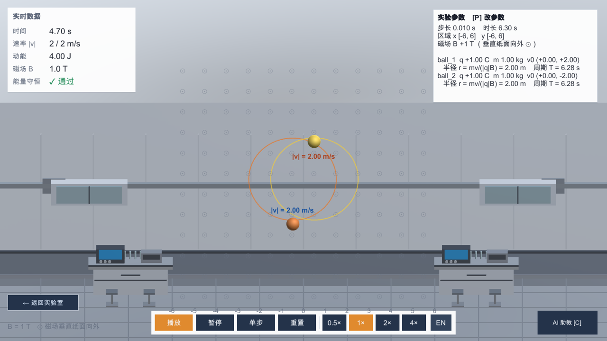
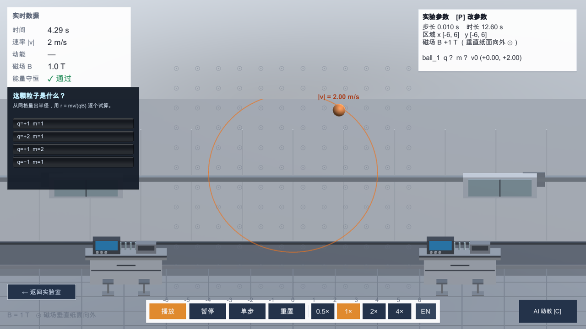

Lesson 3 is a genuine challenge. The particle's parameters are shown as `?` and the kinetic energy reads `—` (kinetic energy is ½mv², so showing it would leak the mass). Students can only measure the radius against the grid, substitute into *r = mv/(qB)*, and answer on a four-option card. Once they get it right, the feedback adds the point that actually matters: **a trajectory only fixes the ratio |q|/m, never q and m separately.**

## How lessons 1 and 2 differ

The two chambers run the same code — same replay logic, same widgets, same framing. **The only difference is which quantity you are allowed to move.** That is deliberate: the action the student performs is the same in both (change one quantity, watch the trajectory), so there is no reason for two different interfaces.

| | Lesson 1 (Direction & radius) | Lesson 2 (One variable at a time) |
|---|---|---|
| What you can change | **Everything is frozen**; you can only switch case | **Speed only** (vx / vy); the rest is frozen |
| Number of cases | 3 pairs | 5 groups |
| Conclusion to reach | The **sign** of the charge sets the turning direction; the **magnitude** sets the radius | **The period does not depend on speed** |
| Cognitive level | Observe first, then generalise (pattern recognition) | Control one variable at a time to make causality visible (control of variables) |

The parameter panel (`P`) states the rule for the current lesson at the bottom, and locked quantities are shown in grey — visible in value, but not editable. Below the panel there is a **permanent case switcher** (available without pressing `P`): the active case is highlighted in inverted text, and one click switches to another.

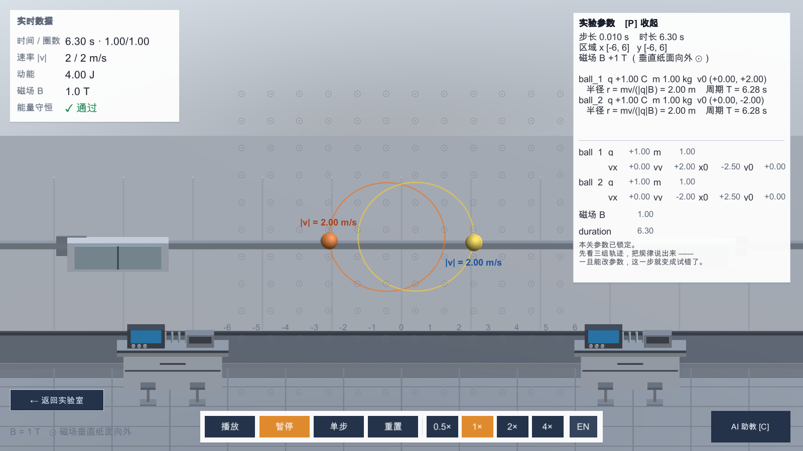
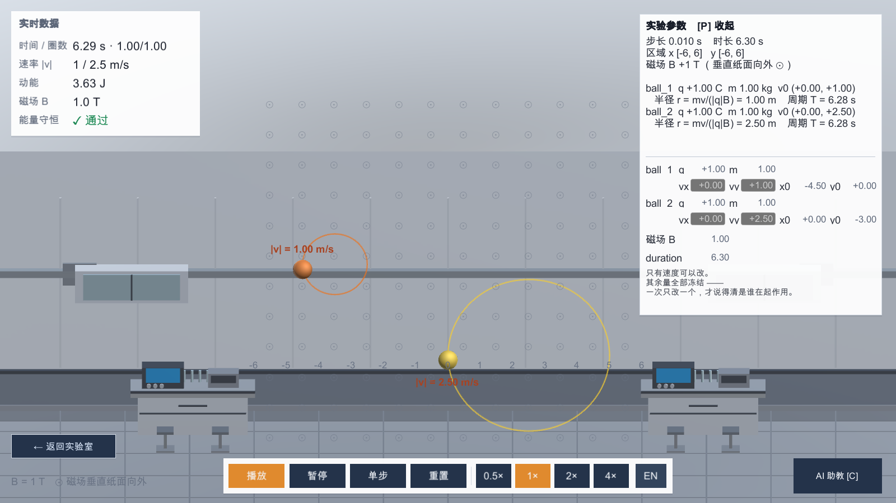

**Why nothing is editable in lesson 1:** the moment students can change parameters, "observe then generalise" collapses into "poke around until something happens". Worse, they carry the habit of fiddling into lesson 2, and the control-of-variables lesson loses its point.

**Why only speed is left open in lesson 2:** with every other quantity and the duration frozen, it becomes physically impossible to change two things at once — the control of variables stops being a verbal instruction and becomes an interface constraint.

### Proving the period with the time / lap-count readout

Whether two periods are equal cannot be judged from the animation: both balls move continuously, and nobody counts laps by eye. So the first HUD cell shows, besides the time, how many laps each charge has completed as `t/T`:

| Case opened | First HUD cell | What it shows |
|---|---|---|
| `speed_diff` (v = 1.0 / 2.5) | `6.30 s · 1.00/1.00` | Speeds differ by 2.5×, radii are 1.00 and 2.50, yet **the lap counts stay equal** → same period |
| `mass_diff` (m = 1 / 2) | `12.60 s · 2.01/1.00` | Mass doubled, **lap counts separate immediately** → different period |

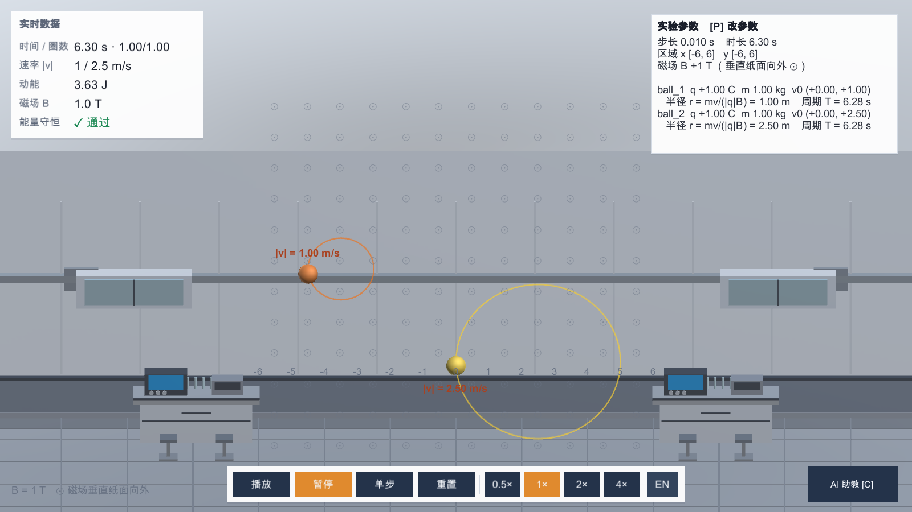
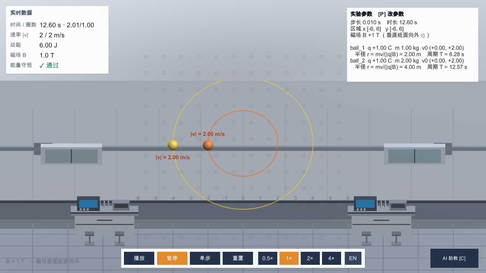

In `speed_diff` the two balls cover 6.28 m and 15.71 m of arc — a ratio of 2.5 — and still close their loops at the same instant. That is more convincing than any spoken explanation.

**Do not mistake the clip duration for the period.** In this dataset the duration is 6.30 s and the period 6.28 s, which is uncomfortably close. Switch to the strong-field case (`field_strong`) and the two separate cleanly: duration 6.30 s, period 3.14 s.

## What each of the three lessons establishes

The three chambers form a chain: **lesson 1 reads the phenomenon (sign and magnitude) → lesson 2 separates the two outputs (what sets the beat, what sets the size) → lesson 3 inverts it (recover the invisible q/m from a measurable radius)**. The numbers below are taken directly from `Assets/StreamingAssets/SimData/`.

### Lesson 1 — splitting q into "sign" and "magnitude"

Fixed at B = 1.0 T, m = 1.0, |v| = 2.0 m/s. The three presets differ **only in charge**:

| Case | What changes | ball_1 | ball_2 | What it establishes |
|---|---|---|---|---|
| `same_q` | Only the start point and the velocity direction are opposite | q=+1, r=2.00, T=6.28 | q=+1, r=2.00, T=6.28 | Identical r and T → **trajectory shape does not depend on where the particle starts**, only on q, m, v, B |
| `opposite_q` | Only the sign of q | q=+1, r=2.00, T=6.28 | q=−1, r=2.00, T=6.28 | Radius and period are identical, only the winding direction flips → **the sign is a direction, not a size** |
| `different_qm` | Only the magnitude \|q\| | q=+1, r=2.00, 1.00 lap | q=+2, r=1.00, 2.01 laps | Doubling the charge halves radius and period together → **a larger \|q\| turns more sharply**, which is the opposite of the "more charge, more sluggish" intuition |

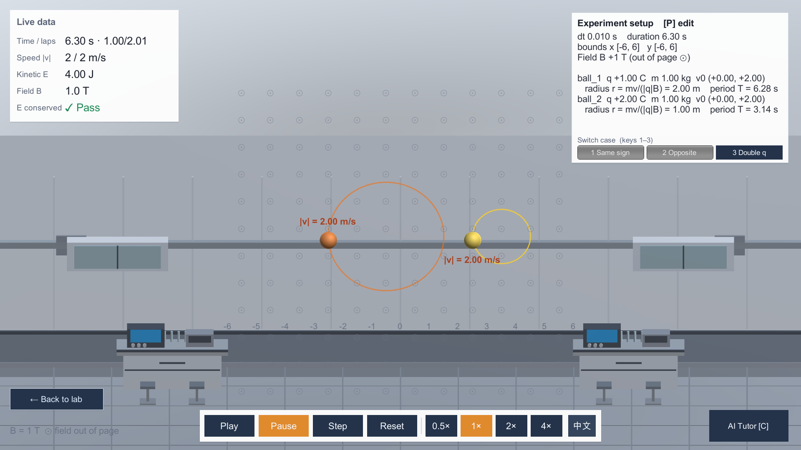

### Lesson 2 — pulling radius and period apart

| Case | What changes | Key numbers | What it establishes |
|---|---|---|---|
| `speed_diff` | Two balls at v = 1.0 / 2.5 | r = 1.00 / 2.50, T = 6.28 both, **laps 1.00 / 1.00** | **Speed scales the radius and leaves the beat untouched** — the most counter-intuitive frame in the whole lesson |
| `field_weak` | B = 0.5 | r = 4.00, T = 12.57, 1.00 lap | Half the field → double the radius and double the period (r ∝ 1/B) |
| `field_strong` | B = 2.0 | r = 1.00, T = 3.14, **2.01 laps in 6.3 s** | Double the field → half the radius and half the period |
| `mass_diff` | m = 1 / 2 | r = 2.00 / 4.00, T = 6.28 / 12.57, **laps 2.01 / 1.00** | Mass changes the beat → the two balls **fall out of step** |
| `no_field` | B = 0 | Straight line at constant speed | No field, no force (the control case) |

`speed_diff` and `mass_diff` are the sharpest pair in the lesson: both make one ball "run harder", but changing v keeps the two in step while changing m tears the synchronisation apart immediately.

### Lesson 3 — inferring the invisible from the measurable

All the student sees is a radius of 4.00 m (counted on the grid), a speed of 2 m/s, a field of 1 T, and one lap every 12.6 s; q and m are shown as `?`. Rearranging *r = mv/(qB)*:

```
q/m = v / (B·r) = 2 / (1 × 4) = 0.5
```

| Option | q, m | q/m | How to rule it out |
|---|---|---|---|
| A | +1, 1 | 1.0 | Would give a radius of 2 m, half the measured value |
| B | +2, 1 | 2.0 | Would give a radius of 1 m |
| **C ✓** | +1, 2 | **0.5** | Matches the measured 4 m, and the turning direction is right |
| D | −1, 1 | −1.0 | Ruled out by the winding direction alone — a negative charge turns the other way |

The real teaching moment is the line shown after a correct answer: **a trajectory fixes only the ratio |q|/m; it cannot separate q from m.** (0.5 is equally consistent with +1/2 and +2/4, and the screen cannot tell them apart.) That is the doorway into the concept of charge-to-mass ratio.

### The three lessons side by side

| | Lesson 1 | Lesson 2 | Lesson 3 |
|---|---|---|---|
| Student's role | Watch | Manipulate | Calculate |
| Quantity moved | None (three charge presets) | Speed only | None (parameters hidden) |
| Compared on screen | Radius + lap count | Radius + lap count | Radius (measured) |
| Conclusion | Sign sets direction, \|q\| sets size | Radius ≠ period; v moves only the former | Only \|q\|/m is recoverable |
| In one phrase | Change the sign, change the size | Separate two outputs | Run it backwards |

Step-by-step operation, the order of in-class questions, the 45-minute time allocation and the usual problems are in **[`docs/lesson-1-3-guide.md`](docs/lesson-1-3-guide.md)**.

## Lesson 4 — the parallel-plate deflection range

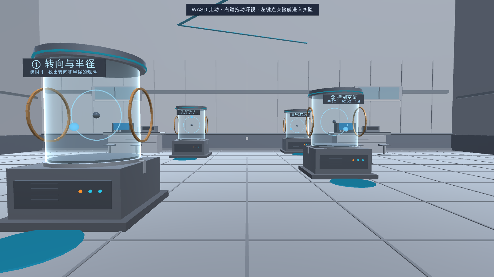

The fourth chamber in the hub is a horizontally mounted parallel-plate range: two plates (upper positive, lower negative), an electron stream flowing downward between them, a ball fixed at the left end, and a green target plate at the lower right. Inside, four sliders set the voltage `U`, charge `q`, mass `m` and launch speed `v₀`; press space to fire and watch whether the ball lands on the green target or misses.

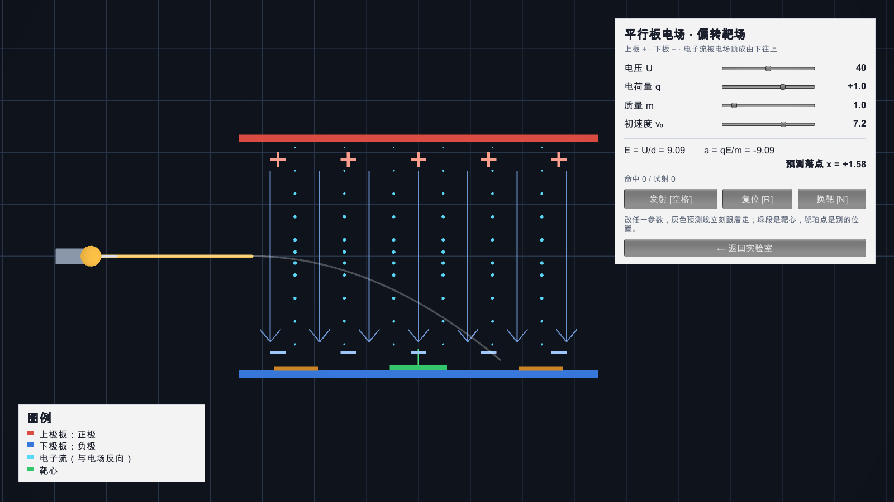

**The default setup deliberately misses.** At `v₀ = 7.2` the impact point is 1.58 m to the right, so the first shot produces a red "off by 1.58 m" result card, and the red projection line (the grey dashed line is the predicted impact) shows at a glance that the landing point is right of the target.

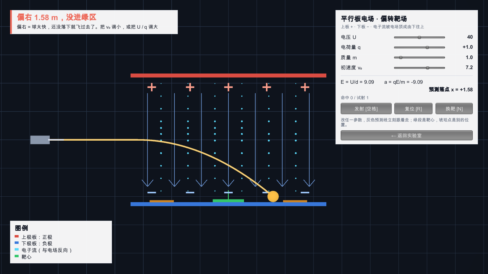

Drag `v₀` to about 4.8 and the grey prediction line slides into the green target in real time — **the parabola is redrawn continuously as the slider moves**, so the shot can be predicted without firing — and the next shot earns a green "hit" card. To show the opposite failure, drag `v₀` down to 3.0 and the impact lands 1.21 m left of the target. The advice for the two failures is opposite (too far right: decrease; too far left: increase), so the two cards are worded separately.

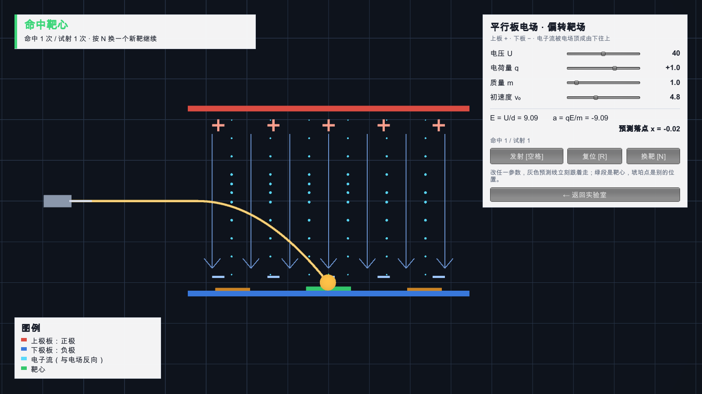

The physics is the textbook relation. The ball enters the plate region horizontally along the centre line (entry at x = −3.2, y = 0); the field between the plates is `E = U/d`, the acceleration is `a = qU/(md)`, and reaching the inner surface of the lower plate requires Δy = 2.0 m:

```
t = √(2Δy / a)                  ← depends only on a, not on v₀
x_impact = −3.2 + v₀ · t
```

That makes the direction of each parameter obvious: a larger `v₀` moves the impact right; larger `U`, larger `q` or smaller `m` raise `a`, shorten `t` and move the impact left. Move any slider and the grey prediction line is redrawn immediately — **the parabola really does follow the slider in real time.** The `G` key toggles the prediction line, so it can be hidden in class and the students asked to guess first.

The full shot list, the reference parameter table and the grading thresholds are in [`docs/plate-field-guide.md`](docs/plate-field-guide.md).

## Features

**Lab hub (2.5D first person)** — four glass chambers: three magnetic-field lessons plus the deflection range. Walk with WASD, look around by dragging with the right mouse button, click a chamber or press `1/2/3/4` to enter, `Esc` to return to the hub facing the chamber you just left.

**Physics replay** — driven by frame-sequence JSON, with play / pause / single-step / reset / 0.5×–4× speed; a coordinate grid with tick labels, magnetic-field symbols (⊙ out of the page, ⊗ into the page), trajectory lines and the theoretical circle for reference, velocity labels on each particle, and a live data card (speed, kinetic energy, field strength, energy-conservation check).

**Parameter panel (`P`)** — change charge q, mass m, initial speed v, field strength B, time step and grid spacing, then "recompute and play" to run the solver in place. A one-click "restore case" is always available. In lesson 3 the panel masks q/m/r/T and disables the `P` key.

**Parallel-plate range** — analytic rather than stepped (uniform acceleration between the plates, straight line outside), with four sliders that recompute the whole parabola in real time; the electron stream is rendered as a particle chain, and impacts are graded as hit / graze / miss.

**Bilingual UI** — Chinese and English, toggled with one key; both languages were run through the acceptance pass.

## Getting started

1. Install **Unity 2022.3.14f1c1** (other 2022.3.x releases generally open it too).
2. Unity Hub → Add → select this repository folder → open.
3. Open `Assets/Scenes/Main.unity` and press Play.

To produce a Windows build from the command line:

```bash
Unity.exe -batchmode -quit -projectPath <repo-path> \
  -executeMethod BuildWin.RebuildAndBuild -logFile build.log
# output: <parent-of-repo>/_build/Win64/ChargeMotionLab.exe
```

> ⚠️ Having both `http_proxy` and `HTTP_PROXY` set crashes Unity's Bee build backend. `unset` every proxy variable before building.

## Controls

| Where | Key | Action |
|---|---|---|
| Hub | `W A S D` / right-drag | Walk / look around |
| Hub | left-click a chamber, `1` `2` `3` `4` | Enter that lesson / the range |
| In a lesson | `P` | Parameter panel (fully locked in lesson 1, speed only in lesson 2, disabled in lesson 3) |
| Lessons 1 & 2 | `1`…`5`, or the switcher under the panel | Change preset (the active one is in inverted text) |
| In a lesson | `Space` / on-screen button | Play / pause (in the range: fire) |
| In a lesson | `C` | AI tutor |
| In a lesson | `F5` | Re-read the current JSON |
| In a lesson | `Esc` | Back to the hub |
| Range | Drag the four sliders | Set U / q / m / v₀; the parabola is redrawn live |
| Range | `G` | Toggle the grey prediction line (hide it and let students guess first) |
| Range | `R` / `N` | Reset this shot / randomise the target position |
| Navigator | `Space` / `R` | Launch / reset |
| Navigator | `G` / `V` | Toggle the grey predicted arc / toggle the previous-trajectory comparison |
| Navigator | `1` `2` `3` / `B` | Switch level / flip the field direction in level 1 |
| Navigator | `N` | Randomise the receiver in level 3 |

## Command-line acceptance checks

```bash
ChargeMotionLab.exe -autotest D:/out.txt -lang en
ChargeMotionLab.exe -autoshot D:/shot.png -dataset SimData/same_q.json -shotdelay 3 -lang en
ChargeMotionLab.exe -autoshot D:/hall.png -starthub -shotdelay 4          # hub
ChargeMotionLab.exe -autoshot D:/st3.png -starthub -enterstation 2 -shotdelay 6  # straight into lesson 3
ChargeMotionLab.exe -autoshot D:/st4.png -starthub -enterstation 4 -shotdelay 6  # straight into the plate range
ChargeMotionLab.exe -autoshot D:/hit.png -starthub -enterstation 4 -platefire \
  -plateparams 40,1,1,4.8 -shotdelay 8                                   # fire once with the parameters set
ChargeMotionLab.exe -autoshot D:/lock.png -starthub -enterstation 1 -openparams \
  -shotdelay 11                                                          # force the panel open to inspect the locks
ChargeMotionLab.exe -autoshot D:/p2.png -starthub -enterlab -enterstation 1 -preset 2 \
  -shotdelay 11                                                          # open preset 2 in lesson 1
```

⚠️ `-autoshot` leaves the hub closed by default (to keep the older scripts working). **To enter a chamber, and to see the parameter locks, `-starthub` must be passed explicitly** — `-enterstation 2` on its own does not enter the chamber; the capture stays in the single-room view and looks like a success when it is not.

`-preset N` means "open preset N after entering", which is not the same as `-dataset <path>` (an explicit JSON file for AutoShot); the two names are kept apart on purpose.

Always pass **absolute paths** — relative paths are resolved against `persistentDataPath` by `ScreenCapture`.

## Data and the generator

The nine cases live in `Assets/StreamingAssets/SimData/` and are generated by `tools/charge_gen.py` (pure Python, no third-party dependencies):

```bash
python tools/charge_gen.py      # regenerate every case into Assets/StreamingAssets/SimData/
```

The script locates the project by looking for the directory name, so renaming the project folder does not break it. The data format is shared with MomentumLab:

```json
{ "scenario": { "mode": "2d", "time_step": 0.01, "duration": 6.3, "Bz": 1.0,
                "bounds": { "min": [-6, -6], "max": [6, 6] }, "boundary_restitution": 1.0 },
  "objects": [{ "id": "ball_1", "mass": 1.0, "charge": 1.0, "radius": 0.3,
                "position": [-2.5, 0], "velocity": [0, 2.0], "restitution": 1.0 }],
  "frames": [{ "step": 0, "time": 0.0,
               "objects": [{ "id": "ball_1", "position": [-2.5, 0], "velocity": [0, 2.0] }],
               "total_momentum": [0.0, 0.0], "kinetic_energy": 4.0,
               "collision_count": 0, "boundary_contacts": 0 }],
  "analysis": { "validation": "pass", "relative_momentum_error": 0.0 } }
```

The magnetic field is perpendicular to the plane of motion (`Bz`), so the Lorentz force does no work and the kinetic energy must stay constant for the whole clip — which is exactly what the "energy conservation ✓" check in `-autotest` asserts.

## Pitfalls we hit

**Built-in shader variants are stripped from player builds.** The symptom is "fine in the editor, gone in the exe". This project hit three classes of it and ended up writing its own shaders in `Assets/Resources/Shaders/`, loaded with `Resources.Load<Shader>`:

- Standard's `_EMISSION` keyword (glowing strips, indicator lights) → `ChargeLab/Glow`
- Standard's transparent blend (the glass chamber covers) → `ChargeLab/ChamberGlass`
- `Sprites/Default` stripped, with the `Unlit/Color` fallback ignoring vertex colours → every LineRenderer drawn white and therefore invisible on a light background → `ChargeLab/LineColor`

Two more:

- **An orthographic camera framed by setting `position` but not `rotation`.** Coming in from the hub, the camera keeps the "standing in front of a chamber" orientation; the moment the projection turns orthographic and that orientation is oblique, the physical plane is seen edge-on and the screen goes empty. Framing has to straighten `rotation` first.
- **Framing using the aspect ratio of the very first frame** (the window can be a narrow strip at launch), which leaves the orthographic size permanently a size too large. Cache the first-frame aspect, compare every frame afterwards, and re-frame when it changes.

Three more from the fourth module:

- **The background's z was inverted.** The camera sits at z = −12 looking towards +z, so a backdrop at −1.2 is in front of the lens and the whole screen turns grey. The backdrop belongs behind the plates (z = +0.60).
- **`GUI.skin.label` is light grey by default**, so the labels in the parameter table are nearly invisible on a light background. Every `GUIStyle` needs `normal.textColor` set explicitly.
- **Fixed-height cards break when the English text is longer.** Height has to come from `CalcHeight`, and when the title overflows the font size steps down from 30 to 20 until it fits.

## Repository layout

```
Assets/
  Scenes/Main.unity
  Editor/
    BuildWin.cs                    batch-mode build entry point
    PlaybackSceneBuilder.cs        the scene is generated from code
    ReconcileTest.cs / UIAudit.cs  layout reconciliation and UI audit checks
  Scripts/
    PhysicsPlayback/
      ChargeLabHub.cs              the hub and its four chambers
      LabRoomController.cs         a single lesson room
      PlaybackController.cs        frame-sequence replay
      SimulationLoader.cs / SimulationSolver.cs /
      SimulationSchema.cs / SimulationFileResolver.cs
      PhysicsGrid.cs / SpeedLabels.cs / TrajectoryOverlay.cs
      ParameterPanel.cs            the P panel, locking rules per lesson
      HUDController.cs             HUD, control bar, answer card
      ControlBarState.cs / UISpeedControl.cs / UITheme.cs / UIScale.cs
      ParticleNavigatorModule.cs   lesson 4, default mode
      PlateFieldModule.cs          the parallel-plate deflection range
    AI/                            DeepSeekClient / AIChatPanel / AIConfig /
                                   ExperimentContext
    AutoTest.cs / AutoShot.cs      headless acceptance and screenshots
    LocalizedText.cs / UILang.cs / UILangButton.cs   the bilingual UI
  Resources/Shaders/               hand-written shaders (Glow / ChamberGlass / LineColor)
  StreamingAssets/SimData/         the nine case files (same_q, opposite_q, different_qm,
                                   speed_diff, field_weak, field_strong, mass_diff,
                                   no_field, mystery)
docs/                              screenshots + module notes (plate-field-guide.md,
                                   particle-navigator-guide.md, lesson-1-3-guide.md)
tools/charge_gen.py                case generator
```

> Note on the interface code: the HUD, control bar, parameter panel and theme live **inside `PhysicsPlayback/`** rather than in a separate `UI/` folder — the layout checks in `Editor/ReconcileTest.cs` and `Editor/UIAudit.cs` assume that arrangement.

## Credits

- **Author:** HUANG Jionghua / [@BBBrandon1221](https://github.com/BBBrandon1221)
- Course: EdUHK MSc in AI and Educational Technology · INT6064 Coding and Computational Thinking — group project
- Companion project by the same author: [MomentumLab-INT6066](https://github.com/BBBrandon1221/MomentumLab-INT6066) (conservation of momentum, built on the same replay framework)

## Licence

Coursework code. Fork it, read it, adapt it for your own teaching project — just keep the author's name. No API key is included in this repository: the AI feature needs you to copy `ai_config.sample.json` to `ai_config.json` and add a key beginning with `sk-` (that file is excluded by `.gitignore`).
