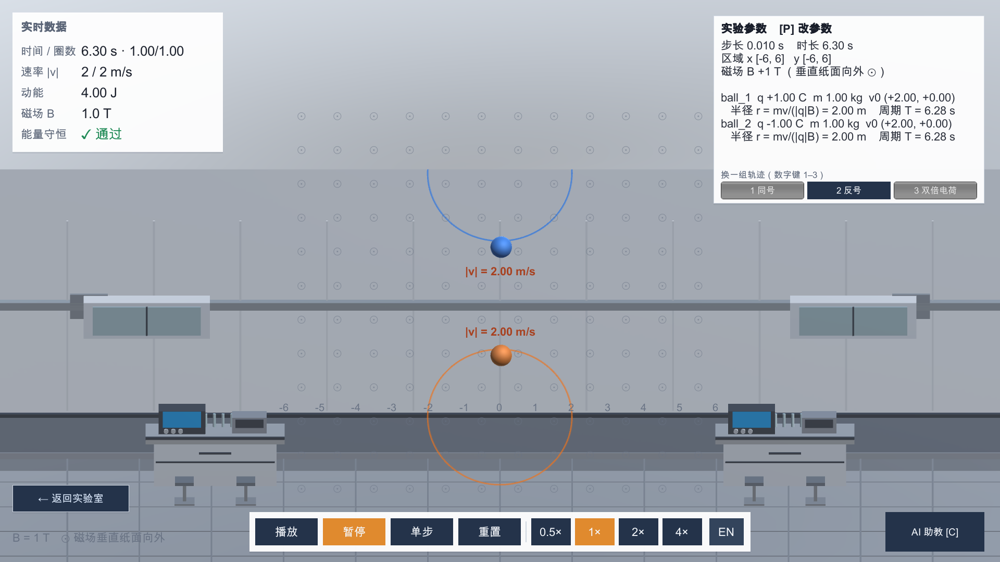
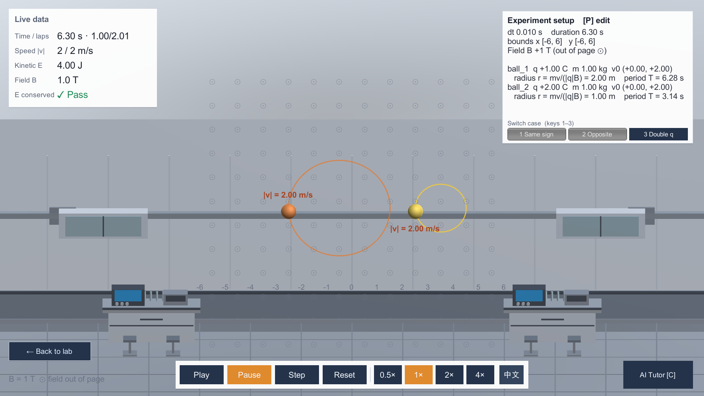
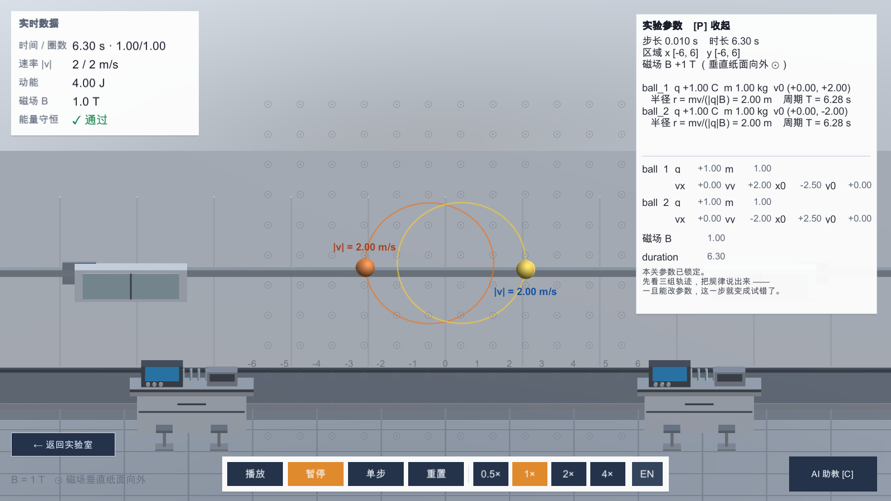
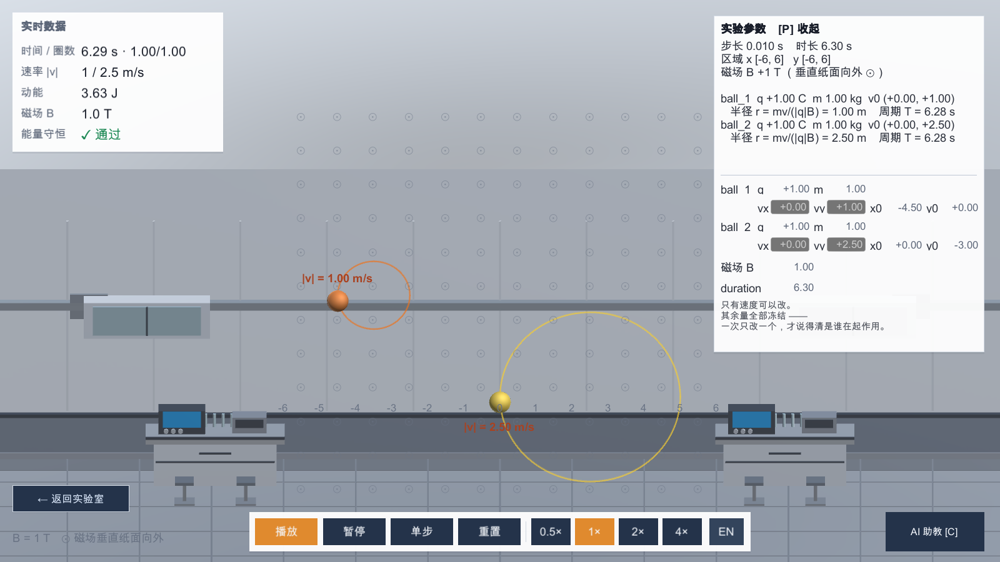
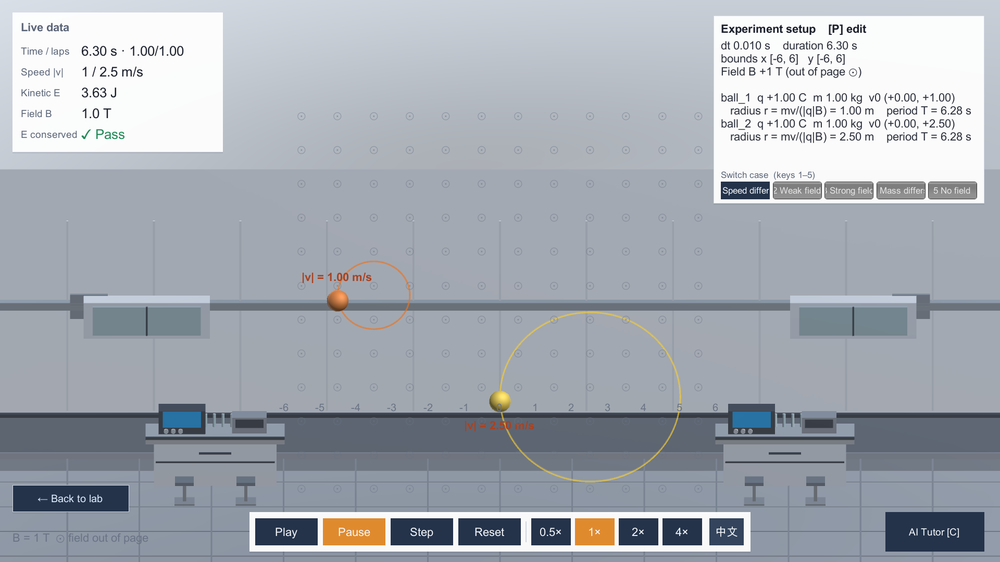

# 前三站操作手册：课时 1–3

**一句话**：三台舱共用同一套界面（右上参数面板、左上实时数据、底部播放条），**差别只在一件事——允许你动哪个量**。这份手册讲清楚：怎么进站、每一步点哪里、屏幕上该看到什么、看到什么算"学生真的懂了"。

> 第四站（粒子导航员）在 [`particle-navigator-guide.md`](particle-navigator-guide.md)，平行板靶场在 [`plate-field-guide.md`](plate-field-guide.md)。本文只讲前三站。

---

## 一、启动与进场

| 做什么 | 怎么做 |
|---|---|
| 启动 | 双击 `_build/Win64/ChargeMotionLab.exe` |
| 在大厅走动 | `W A S D` |
| 环视 | 按住**右键**拖动 |
| 进站 | 左键点舱体，或直接按 `1` `2` `3` `4` |
| 退回大厅 | `Esc`，或参数面板最下面的 **← 返回实验室** |
| 切中英文 | 底部工具栏最右的 `EN` / `中文` |

退出来会站回舱前的观察位，不会回到出生点。

**演示时最省事的进站方式**（跳过走路和吸入动画）：

```bash
ChargeMotionLab.exe -starthub -enterlab -enterstation 1     # 课时一
ChargeMotionLab.exe -starthub -enterlab -enterstation 2     # 课时二
ChargeMotionLab.exe -starthub -enterlab -enterstation 3     # 课时三
```

想直接打开某一组预设，再加 `-preset N`（N 从 1 数起）：

```bash
ChargeMotionLab.exe -starthub -enterlab -enterstation 1 -preset 2    # 进课时一，直接看「反号」那组
```

---

## 二、屏幕上每块是什么（三站通用）

| 位置 | 内容 | 什么时候用 |
|---|---|---|
| 左上「实时数据」 | 时间 / 圈数、速率、动能、磁场 B、能量守恒校验 | **第一格是关键**：`6.30 s · 1.00/1.00` 表示两颗球此刻都转了 1.00 圈 |
| 中间画面 | 坐标网格与刻度、已走轨迹、虚线理论圆、速度标签、场符号 `⊙`/`⊗` | 量半径就靠网格 |
| 右上「实验参数」 | 步长、时长、区域、磁场方向、每颗粒子的 q / m / v₀ / 半径 / 周期 | 归纳公式时的依据 |
| 右上卡片下方 | **换一组轨迹**（切换条，仅课时一、二有） | 换案例，见第六节 |
| 底部工具栏 | 播放 / 暂停 / 单步 / 重置 / 0.5×–4× 倍速 / EN | 想让学生数圈就调慢速 |
| 左下 | 磁场图例 `B = 1 T ⊙ 磁场垂直纸面向外` | 提醒符号含义 |

**场符号别看错**：`⊙` 是垂直纸面向外，`⊗` 是向里。同一颗粒子，场反向 → 转向也反向。

---

## 三、课时一 · 转向与半径

### 3.1 进站

左键点 **① 转向与半径**，或按 `1`。

### 3.2 这一关只有三组，用切换条换

面板下方那条 **「换一组轨迹（数字键 1–3）」** 就是全部操作入口。当前看的是哪一组，用**深底白字**标出来。三组的参数都固定：B = 1.0 T、m = 1.0 kg、|v| = 2.0 m/s，**只差电荷**。

| 按钮 | 参数 | 屏幕上会看到 |
|---|---|---|
| **1 同号** | 两球都 q = +1，速度方向相反 | 两个一样大的圆、同时转完（`1.00/1.00`） |
| **2 反号** | 一球 q = +1、一球 q = −1，速度同向 | 两个一样大的圆，但**一个顺时针、一个逆时针**，仍同步（`1.00/1.00`） |




*上图为「2 反号」。注意看两处：右上切换条里哪个是深底白字（当前组），左上「时间 / 圈数」那两个数是不是还相等。*

### 3.3 带学生看的三步

1. **先看 1 号**，问："两颗球的圆为什么一样大？"（位置不同、方向不同，但形状一样 → 形状只由 q、m、v、B 决定）
2. **切到 2 号**，问："哪里变了、哪里没变？"（**变了**：绕行方向；**没变**：半径 2.00、周期 6.28、圈数 1.00/1.00）
3. **切到 3 号**，问："电荷翻倍，半径和周期各变成多少？"（半径减半 2.00 → 1.00，周期也减半 6.28 → 3.14，所以圈数是 2.01 对 1.00）



*学生用英文界面时，切换条是 `Same sign` / `Opposite` / `Double q`，HUD 的 `Time / laps` 就是中文的「时间 / 圈数」。*

### 3.4 什么算真的懂了

学生能自己说出这两句：

- **符号决定转向**，不改半径、不改周期；
- **电荷量越大转得越急**（半径和周期一起变小），不是"更笨重所以更慢"。

第二句最容易错，一定要让学生先猜再揭晓。

### 3.5 老师按 `P` 会看到什么

面板展开后：所有参数都是**灰色数字**，看得见是多少，没有输入框、没有"重算"按钮。这是故意的——这一关不让人改，一改就变成"拨到画面变对为止"。



### 3.6 常见误区

| 学生说 | 回应 |
|---|---|
| "左边那颗球转得慢一点" | 看 HUD 第一格，两颗都是 `1.00`。位置不同不等于节拍不同 |
| "转向反了说明电荷大" | 反号那组的半径和周期跟前一组完全一样，只反了方向 → 反号只改方向 |
| "圈数不一样是因为位置不同" | 3 号组两颗起点一样，圈数还是 1.00 对 2.01 → 是电荷量的区别 |

---

## 四、课时二 · 控制变量

### 4.1 进站

左键点 **② 控制变量**，或按 `2`。切换条变成五个按钮（`1`–`5`）。

### 4.2 五个预设各证明什么

| 按钮 | 谁变了 | 半径 | 周期 | 圈数 |
|---|---|---|---|---|
| **1 速度不同** | 两球 v = 1.0 / 2.5 | 1.00 / 2.50 | 6.28 / 6.28 | **1.00 / 1.00** |
| **2 弱场** | B = 0.5 | 4.00 | 12.57 | 1.00 |
| **3 强场** | B = 2.0 | 1.00 | 3.14 | 2.01（6.3 s 转两圈） |
| **4 质量不同** | m = 1 / 2 | 2.00 / 4.00 | 6.28 / 12.57 | **2.01 / 1.00** |
| **5 无磁场** | B = 0 | — | — | 走直线 |



*这一格是整节课的关键证据：半径差 2.5 倍，圈数一模一样。*

英文界面下五个按钮依次是 `Speed differ` / `Weak field` / `Strong field` / `Mass differ` / `No field`（按钮太窄时文字会被截断，属正常）：



### 4.3 唯一的操作：改速度

这是前三站里**唯一能动手改参数**的地方。

1. 按 `P` 展开参数面板；
2. 只有 `vx`、`vy` 是**白色输入框**，其他全是灰字；
3. 改完点 **重算并播放**，画面按新速度重跑；
4. 想回到原始数据，点 **恢复原案例**。

> `vx` / `vy` 必须一起看：只改一个分量，方向会跟着变，"改速度"就偷偷变成了"改方向"。

### 4.4 带学生看的两步

1. **先切 1 号**（速度不同）：两颗球一个圆大一个圆小，但 HUD 的圈数**始终相等**。问："跑得快的那颗，是不是一圈用得更少？"——不是。
2. **再切 4 号**（质量不同）：这回圈数分开了（`2.01 / 1.00`）。问："同样都是让一颗球跑得更猛，为什么这次不同步了？"

### 4.5 什么算真的懂了

- 速度只放大半径，**不动节拍**；
- 质量和磁场改的才是节拍；
- 所以 `r = mv/(qB)` 和 `T = 2πm/(qB)` 里的 v 只出现在分子、只影响 r。

### 4.6 别踩的坑

- **播放时长 ≠ 周期**：1 号组时长 6.30 s、周期 6.28 s，两个数太像。切到 3 号组就清楚：时长还是 6.30 s，周期变成 3.14 s。
- **时长是锁死的**：一旦能改时长，HUD 的圈数就成了可以随手操纵的数字，"同时转完一圈"这条证据当场失效。

---

## 五、课时三 · 未知粒子

### 5.1 进站

左键点 **③ 未知粒子**，或按 `3`。

### 5.2 屏幕上有什么

| 元素 | 状态 |
|---|---|
| 电荷 q、质量 m | 显示为 `?`，参数面板展开不了（按 `P` 无反应，是设计如此） |
| 速率 v | 2 m/s（给） |
| 磁场 B | 1 T（给） |
| 半径 r | **不给，要自己量** |
| 动能 | 显示 `—`（因为 ½mv² 给了 v 就能反算 m，会漏答案） |

### 5.3 学生怎么做

1. 数网格：从圆心到轨迹，量出半径 **4.00 m**；
2. 用 `r = mv/(qB)` 变形：`q/m = v/(B·r) = 2 / (1 × 4) = 0.5`；
3. 在**左侧那张深色作答卡**上点选（卡上写着"这颗粒子是什么？"，四个选项 A–D）：

| 选项 | q、m | q/m | 排除理由 |
|---|---|---|---|
| A | +1、1 | 1.0 | 半径会算成 2 m，只有实测的一半 |
| B | +2、1 | 2.0 | 半径会算成 1 m |
| **C ✓** | +1、2 | **0.5** | 与实测 4 m 吻合，转向也对 |
| D | −1、1 | −1.0 | 先看转向就该排除——负电荷绕向相反 |

4. 答错可以点卡上的 **再量一次** 重来；答对后卡片会给两句判定。

### 5.4 答对之后必须追问的那句话

答对时屏幕给两句：`对了。r = 4.0 m，v = 2 m/s，B = 1 T → q/m = 0.5。` 和 `注意：轨迹只能定出 q/m 的比值，分不出 q 和 m 各是多少。`

学生通常只看懂第一句。老师要把第二句念出来并追问：

> `q/m = 0.5` 可以是 `+1/2`，也可以是 `+2/4` —— **屏幕上看得出区别吗？**

看不出。这就是荷质比（q/m）这个概念存在的理由，也是为什么这一站不能设计成"再精确一点就能测出 q"。

---

## 六、切换条怎么用（课时一、二）

- 位置：右上参数卡片的下方，标题写着 **「换一组轨迹（数字键 1–N）」**；
- **它一直显示**，不需要按 `P`；
- 当前正在看的那组是**深底白字**，其余是浅色按钮；
- 点一下就换，键盘 `1`–`5` 效果一样；
- 课时三只有一份数据，所以**没有**切换条（不是坏了）；第四站也没有。

---

## 七、45 分钟怎么排

| 时间 | 内容 |
|---|---|
| 0–5 min | 大厅自由走一圈，讲清场符号 `⊙`/`⊗` 和网格刻度 |
| 5–18 min | 课时一：三组顺着看，让学生自己归纳两句话 |
| 18–35 min | 课时二：五个预设快过（每个 2 分钟），留 5 分钟让学生自己按 `P` 改速度验证 |
| 35–45 min | 课时三：当作随堂测，量半径 → 四选一 → 补"只能定比值" |

课时二如果时间紧，`弱场` 和 `强场` 可以二选一，但 `速度不同` 和 `质量不同` 这一对必须都看——它是整节课最关键的对照。

---

## 八、常见问题

| 现象 | 原因 | 怎么办 |
|---|---|---|
| 画面全黑 / 停在灰色房间 | 缺 `-starthub`，或没进站 | 命令行加 `-starthub`；手动则走到舱前再点 |
| 点了舱体没反应 | 离得太远，或准星没落在舱上 | 走近到舱体前，准星对着玻璃舱面（选中时舱体会高亮）再点 |
| 按 `P` 没反应 | 课时三（参数被遮蔽），或在大厅里（键盘归大厅） | 课时三是设计如此；大厅里要先点舱进站 |
| 改了数字画面不动 | 没点「重算并播放」 | 改完必须点按钮，或按面板上的提示 |
| 找不到切换条 | 在课时三 / 第四站，或没进站 | 只在课时一、二出现 |
| 中文显示成方块 | 字体缺字 | 用仓库里打包的版本，别自己换 font |
| 窗口太小看不清刻度 | 分辨率 | 全屏，或至少 1600×900 |
| 想重来一遍 | — | 点「恢复原案例」回到 json 原始数据；或按 `F5` 重读当前文件 |

---

## 九、命令行验收（出图用）

```bash
# 课时一：三组各出一张
ChargeMotionLab.exe -autoshot D:/st1_a.png -starthub -enterlab -enterstation 1 -preset 1 -shotdelay 11
ChargeMotionLab.exe -autoshot D:/st1_b.png -starthub -enterlab -enterstation 1 -preset 2 -shotdelay 11
ChargeMotionLab.exe -autoshot D:/st1_c.png -starthub -enterlab -enterstation 1 -preset 3 -shotdelay 11

# 课时二：速度不同 / 质量不同
ChargeMotionLab.exe -autoshot D:/st2_a.png -starthub -enterlab -enterstation 2 -preset 1 -shotdelay 11
ChargeMotionLab.exe -autoshot D:/st2_b.png -starthub -enterlab -enterstation 2 -preset 4 -shotdelay 11

# 展开参数面板，给「锁定状态」出图
ChargeMotionLab.exe -autoshot D:/lock.png -starthub -enterlab -enterstation 1 -openparams -shotdelay 11

# 英文版
ChargeMotionLab.exe -autoshot D:/en.png -starthub -enterlab -enterstation 1 -preset 2 -lang en -shotdelay 11
```

⚠️ **必须带 `-starthub`**：`-autoshot` 默认把大厅关掉（保持老脚本行为），只写 `-enterstation N` 不会真的进站，画面会停在单一实验房间里，看着像成功其实没进去。

路径一律给**绝对路径**，相对路径会被 `ScreenCapture` 写到 `persistentDataPath` 里去。

---

## 十、想加一组新数据怎么办

1. 在 `Assets/StreamingAssets/SimData/` 下复制一份现有 json 改参数（`scenario.Bz` 是场强，`objects[].charge / mass / velocity / position` 是粒子）；
2. 在 `ChargeLabHub.cs` 的 `StationDatasets` 里把文件名加进对应那一站的数组；
3. 在 `UILang.cs` 里补一条短标签，key 是 `ds.<文件名去扩展名>`（例如 `ds.my_case`）。**不补也不会崩**，按钮上会直接显示文件名，只是不好看。

---

*前三站共用 `ParameterPanel` / `SceneBinder` / `HUDController`；修改界面统一走 `UITheme` 和 `UILang`，不要在各个面板里各写一套颜色和文案。*
